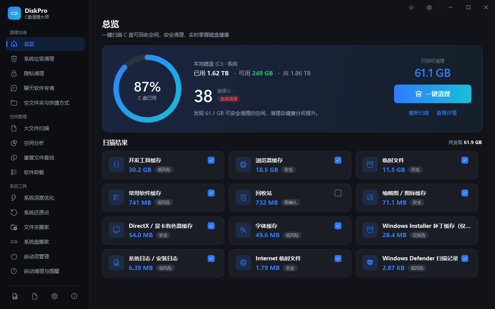
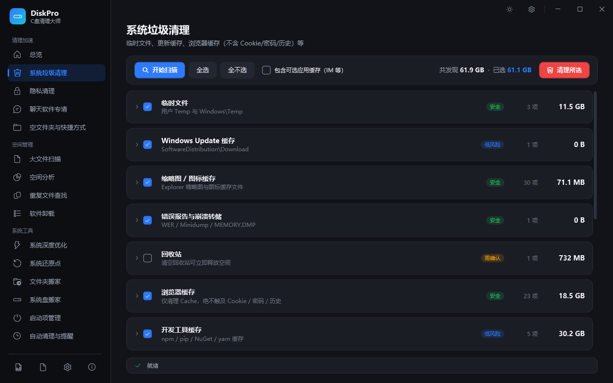
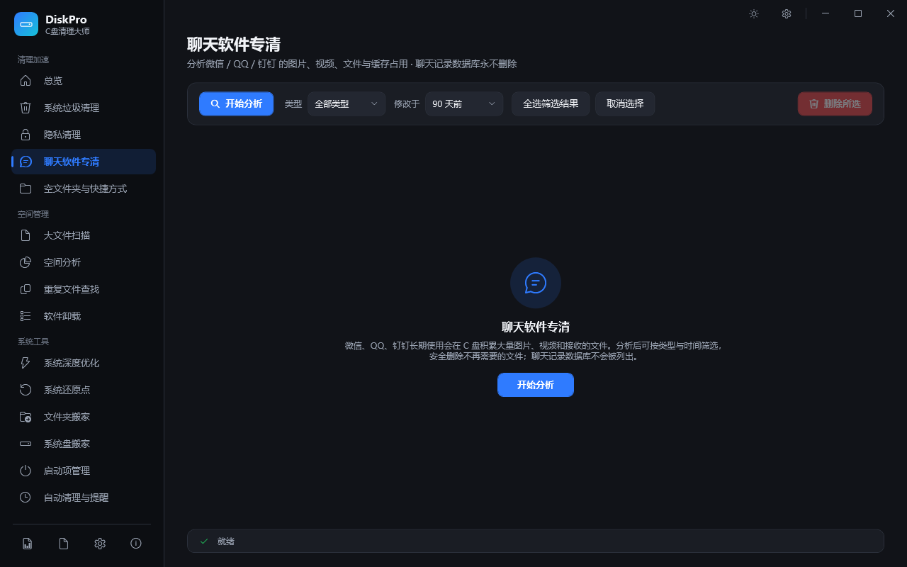
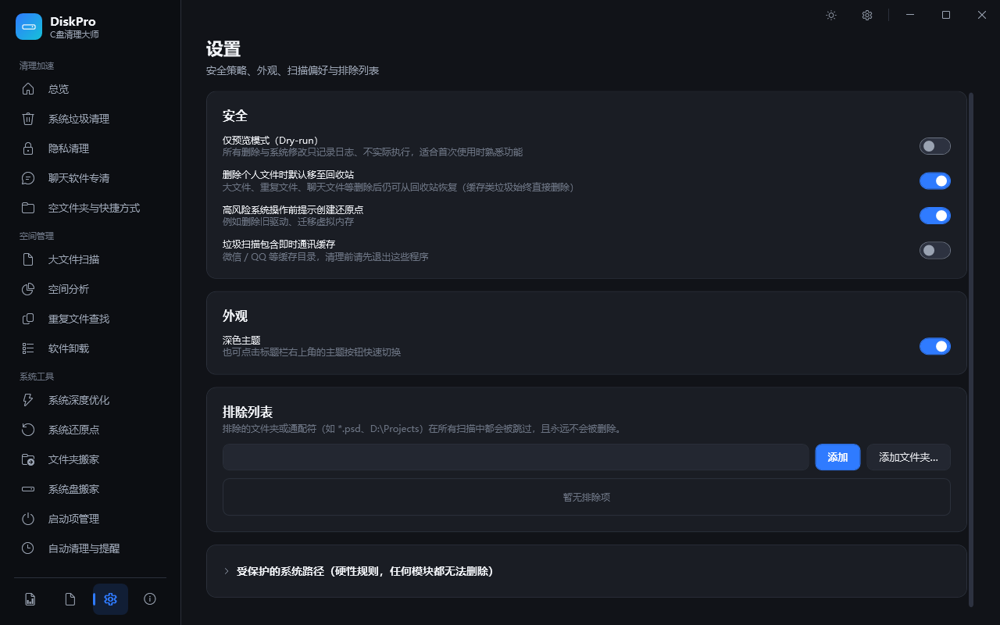

# DiskPro

**2.0.0** · 面向 Windows 10 / 11 的 C 盘清理工具。原生 WPF 界面，原则是：先预览、后确认、可回收、有日志。

## 界面截图



*总览 / Dashboard*



*垃圾清理 / Junk cleanup*



*聊天软件专清 / Chat-app cleanup*



*设置 / Settings*

## 功能特性

- 先列出将要处理的文件与体积，确认后再执行；默认移入回收站。
- 系统关键目录受硬性保护。
- 垃圾清理、大文件、重复文件、卸载、启动项、空间分析、设置与日志等模块（见源码 README）。
- 支持深色 / 浅色主题，界面全中文。程序清单声明需要管理员权限（UAC）。

## 技术栈

- .NET 8
- WPF（`net8.0-windows`）
- 解决方案：`DiskPro.sln`

## 从源码运行

源码在仓库根目录。本仓库不包含安装包。在 Windows 上：

```bash
dotnet build DiskPro.sln -c Release
dotnet run --project src/DiskPro.App/DiskPro.App.csproj
```
需要 Windows 与 .NET 8 SDK。程序启动时可能弹出 UAC。更完整的模块说明见 `README.original.md`（请忽略其中未包含在本仓库的 release 可执行文件路径）。

## 文档

- [源码 README](README.original.md)

---

## English

# DiskPro

**2.0.0** · A C: drive cleanup tool for Windows 10 / 11. Native WPF UI. The rule is: preview first, confirm next, prefer Recycle Bin, and keep logs.

## Screenshots


*总览 / Dashboard*


*垃圾清理 / Junk cleanup*


*聊天软件专清 / Chat-app cleanup*


*设置 / Settings*

## Features

- Lists files and sizes first and runs only after confirmation; the Recycle Bin is the default destination.
- Critical system directories are hard-protected.
- Modules include junk cleanup, large files, duplicates, uninstall, startup items, space analysis, settings, and logs (see the source README).
- Light/dark themes and a fully Chinese UI. The manifest requests administrator rights (UAC).

## Tech stack

- .NET 8
- WPF（`net8.0-windows`）
- 解决方案：`DiskPro.sln`

## Getting started

Source is at the repository root. This repository does not include installers. On Windows:

```bash
dotnet build DiskPro.sln -c Release
dotnet run --project src/DiskPro.App/DiskPro.App.csproj
```
Requires Windows and the .NET 8 SDK. The app may prompt for UAC. See `README.original.md` for modules; ignore release exe paths that are not in this repository.

## Documentation

- [源码 README](README.original.md)

